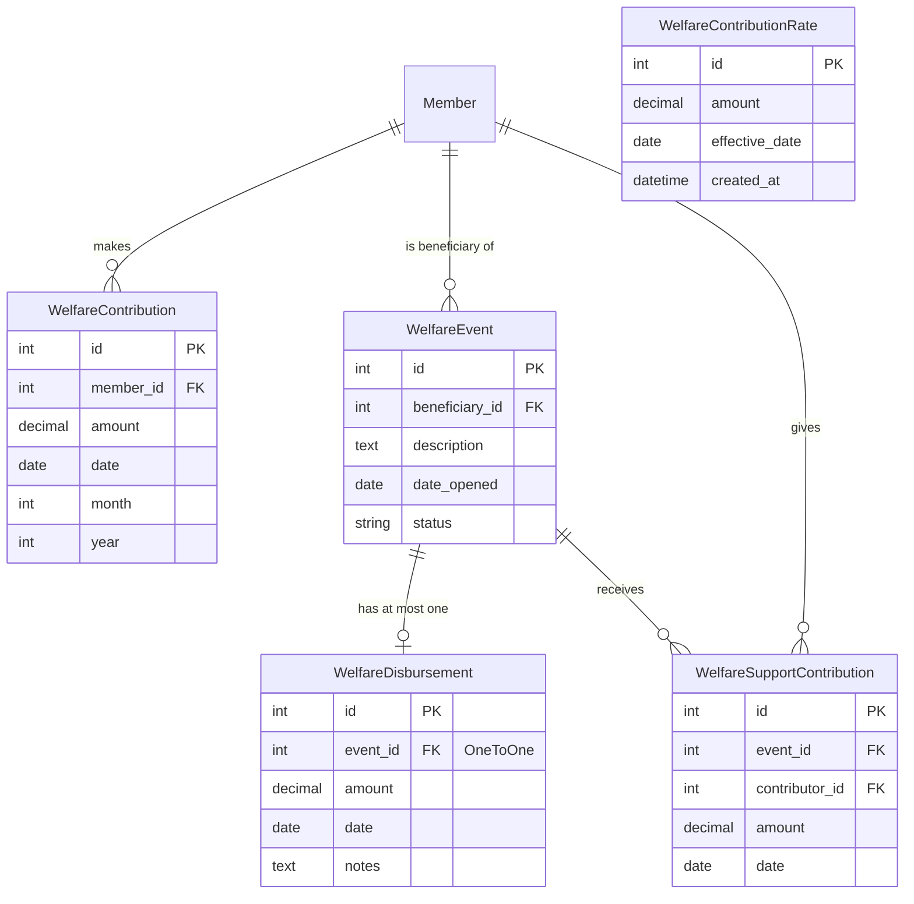

# Design Document — Welfare Kit

## Overview

The Welfare Kit is a new Django app (`welfare`) added to the existing DC Welfare Group chama system. It manages a dedicated welfare fund that is financially and operationally separate from the main chama contributions. The app covers three core flows:

1. **Welfare Fund Contributions** — members make periodic payments into a shared welfare pool.
2. **Emergency Disbursements** — the fund pays out to a member facing an emergency.
3. **Member Support Contributions** — other members voluntarily contribute directly to a specific beneficiary for a given welfare event.

The app follows the same structural conventions as the existing `contributions` and `loans` apps: Django class-based views, Bootstrap 5 templates, AJAX filtering, role-based access via `accounts.mixins`, and export via `utils/exports.py`.

---

## Architecture

The welfare app is a self-contained Django app registered in `INSTALLED_APPS`. It has no runtime dependencies on other apps beyond `members` (for the `Member` FK) and `accounts` (for access control mixins). The main chama contributions ledger is untouched.

```
chama_system/
  welfare/
    __init__.py
    apps.py
    admin.py
    models.py
    forms.py
    views.py
    urls.py
    migrations/
    templates/
      welfare/
        dashboard.html
        contribution_list.html
        contribution_form.html
        contribution_confirm_delete.html
        defaulters.html
        event_list.html
        event_form.html
        event_detail.html
        event_confirm_delete.html
        disbursement_form.html
        disbursement_confirm_delete.html
        support_contribution_form.html
        support_contribution_confirm_delete.html
        rate_form.html
        export_event_summary.html   (PDF-only template, not rendered in browser)
```

The app is mounted at `/welfare/` in the root URL configuration.

### Balance Calculation Approach

The `Welfare_Balance` is **never stored as a field**. It is always computed on demand from DB aggregates — consistent with how `Member.total_loan_balance()` works in the loans app:

```python
from django.db.models import Sum
from decimal import Decimal

def get_welfare_balance():
    total_in  = WelfareContribution.objects.aggregate(t=Sum('amount'))['t'] or Decimal('0')
    total_out = WelfareDisbursement.objects.aggregate(t=Sum('amount'))['t'] or Decimal('0')
    return total_in - total_out
```

This function is called in every view that needs the balance (dashboard, disbursement create/edit). There is no signal or stored field to keep in sync.

---

## Components and Interfaces

### Models

#### `WelfareContributionRate`

Stores the expected monthly contribution amount. Only one rate is "current" at any time — the one with the most recent `effective_date` on or before the queried period.

```python
class WelfareContributionRate(models.Model):
    amount = models.DecimalField(max_digits=10, decimal_places=2,
                                 validators=[MinValueValidator(Decimal('0.01'))])
    effective_date = models.DateField()
    created_at = models.DateTimeField(auto_now_add=True)

    class Meta:
        ordering = ['-effective_date']

    def __str__(self):
        return f"KES {self.amount} from {self.effective_date}"

    @classmethod
    def current_rate(cls):
        """Return the rate in effect today, or None if none configured."""
        from django.utils import timezone
        today = timezone.localdate()
        return cls.objects.filter(effective_date__lte=today).first()

    @classmethod
    def rate_for_period(cls, year, month):
        """Return the rate in effect for the first day of the given month/year."""
        import datetime
        period_start = datetime.date(year, month, 1)
        return cls.objects.filter(effective_date__lte=period_start).first()
```

#### `WelfareContribution`

A periodic payment from a member into the welfare fund.

```python
class WelfareContribution(models.Model):
    member = models.ForeignKey('members.Member', on_delete=models.CASCADE,
                               related_name='welfare_contributions')
    amount = models.DecimalField(max_digits=10, decimal_places=2,
                                 validators=[MinValueValidator(Decimal('0.01'))])
    date   = models.DateField()
    month  = models.IntegerField(choices=MONTH_CHOICES)
    year   = models.IntegerField()

    class Meta:
        ordering = ['-date']

    def __str__(self):
        return f"{self.member.name} — KES {self.amount} ({self.get_month_display()} {self.year})"
```

`month` and `year` are derived from `date` in the form's `save()` method (same pattern as `contributions.forms.ContributionForm`).

#### `WelfareEvent`

An emergency case opened for a specific beneficiary.

```python
class WelfareEvent(models.Model):
    STATUS_CHOICES = [('open', 'Open'), ('closed', 'Closed')]

    beneficiary  = models.ForeignKey('members.Member', on_delete=models.CASCADE,
                                     related_name='welfare_events')
    description  = models.TextField()
    date_opened  = models.DateField()
    status       = models.CharField(max_length=10, choices=STATUS_CHOICES, default='open')

    class Meta:
        ordering = ['-date_opened']

    def __str__(self):
        return f"Event #{self.pk} — {self.beneficiary.name} ({self.get_status_display()})"

    @property
    def disbursement_amount(self):
        """Amount paid from the fund for this event (0 if no disbursement recorded)."""
        d = getattr(self, '_disbursement_cache', None)
        if d is None:
            try:
                d = self.disbursement.amount
            except WelfareDisbursement.DoesNotExist:
                d = Decimal('0')
        return d

    @property
    def support_total(self):
        """Sum of all member support contributions for this event."""
        return self.support_contributions.aggregate(
            t=Sum('amount'))['t'] or Decimal('0')

    @property
    def event_total(self):
        """Total support received: fund disbursement + member support contributions."""
        return self.disbursement_amount + self.support_total
```

#### `WelfareDisbursement`

A payment from the welfare fund to a beneficiary. At most one per event (enforced by `OneToOneField`).

```python
class WelfareDisbursement(models.Model):
    event  = models.OneToOneField(WelfareEvent, on_delete=models.CASCADE,
                                  related_name='disbursement')
    amount = models.DecimalField(max_digits=10, decimal_places=2,
                                 validators=[MinValueValidator(Decimal('0.01'))])
    date   = models.DateField()
    notes  = models.TextField(blank=True)

    class Meta:
        ordering = ['-date']

    def __str__(self):
        return f"Disbursement #{self.pk} — KES {self.amount} for Event #{self.event_id}"
```

The one-disbursement-per-event constraint is enforced at the DB level by `OneToOneField` and at the form level by checking for an existing disbursement before allowing creation.

#### `WelfareSupportContribution`

A voluntary payment from one member directly to a beneficiary for a specific event.

```python
class WelfareSupportContribution(models.Model):
    event       = models.ForeignKey(WelfareEvent, on_delete=models.CASCADE,
                                    related_name='support_contributions')
    contributor = models.ForeignKey('members.Member', on_delete=models.CASCADE,
                                    related_name='welfare_support_given')
    amount      = models.DecimalField(max_digits=10, decimal_places=2,
                                      validators=[MinValueValidator(Decimal('0.01'))])
    date        = models.DateField()

    class Meta:
        ordering = ['-date']

    def __str__(self):
        return f"{self.contributor.name} → Event #{self.event_id}: KES {self.amount}"
```

### Forms

All forms follow the same pattern as `contributions/forms.py`:

| Form | Model | Key validation |
|---|---|---|
| `WelfareContributionRateForm` | `WelfareContributionRate` | `amount > 0` |
| `WelfareContributionForm` | `WelfareContribution` | `amount > 0`; derives `month`/`year` from `date` in `save()` |
| `WelfareEventForm` | `WelfareEvent` | required fields only |
| `WelfareDisbursementForm` | `WelfareDisbursement` | `amount > 0`; `amount <= welfare_balance` (balance injected via `__init__`); event has no existing disbursement |
| `WelfareSupportContributionForm` | `WelfareSupportContribution` | `amount > 0`; `contributor != event.beneficiary` |

`WelfareDisbursementForm` receives the current balance at instantiation:

```python
class WelfareDisbursementForm(forms.ModelForm):
    def __init__(self, *args, welfare_balance=None, **kwargs):
        super().__init__(*args, **kwargs)
        self._welfare_balance = welfare_balance

    def clean_amount(self):
        amount = self.cleaned_data.get('amount')
        if amount is None or amount <= 0:
            raise ValidationError('Disbursement amount must be greater than zero.')
        if self._welfare_balance is not None and amount > self._welfare_balance:
            raise ValidationError(
                f'Disbursement amount exceeds the available welfare balance '
                f'of KES {self._welfare_balance:,.2f}.'
            )
        return amount
```

### Views

All views use class-based views. Access control follows the existing pattern:

| Mixin | Roles | Used for |
|---|---|---|
| `MemberAccessMixin` | admin, treasurer, readonly | List, detail, dashboard views |
| `TreasurerRequiredMixin` | admin, treasurer | Create, edit, export views |
| `AdminRequiredMixin` | admin only | Delete views |

### URL Structure

```
app_name = 'welfare'

/welfare/                                  → WelfareDashboardView          (name='dashboard')
/welfare/contributions/                    → WelfareContributionListView   (name='contribution_list')
/welfare/contributions/add/                → WelfareContributionCreateView (name='contribution_add')
/welfare/contributions/export/             → WelfareContributionExportView (name='contribution_export')
/welfare/contributions/defaulters/         → WelfareDefaultersView         (name='defaulters')
/welfare/contributions/defaulters/export/  → WelfareDefaultersExportView   (name='defaulters_export')
/welfare/contributions/<pk>/edit/          → WelfareContributionUpdateView (name='contribution_edit')
/welfare/contributions/<pk>/delete/        → WelfareContributionDeleteView (name='contribution_delete')
/welfare/rate/                             → WelfareContributionRateView   (name='rate')
/welfare/events/                           → WelfareEventListView          (name='event_list')
/welfare/events/add/                       → WelfareEventCreateView        (name='event_add')
/welfare/events/<pk>/                      → WelfareEventDetailView        (name='event_detail')
/welfare/events/<pk>/edit/                 → WelfareEventUpdateView        (name='event_edit')
/welfare/events/<pk>/delete/               → WelfareEventDeleteView        (name='event_delete')
/welfare/events/<pk>/close/                → WelfareEventCloseView         (name='event_close')
/welfare/events/<pk>/disbursement/add/     → WelfareDisbursementCreateView (name='disbursement_add')
/welfare/events/<pk>/disbursement/edit/    → WelfareDisbursementUpdateView (name='disbursement_edit')
/welfare/events/<pk>/disbursement/delete/  → WelfareDisbursementDeleteView (name='disbursement_delete')
/welfare/events/<pk>/support/add/          → WelfareSupportCreateView      (name='support_add')
/welfare/events/<pk>/support/export/       → WelfareEventExportView        (name='event_export')
/welfare/support/<pk>/edit/                → WelfareSupportUpdateView      (name='support_edit')
/welfare/support/<pk>/delete/              → WelfareSupportDeleteView      (name='support_delete')
```

---

## Data Models

### Entity-Relationship Diagram



### Balance Computation

The welfare balance is a pure aggregate — no stored field:

```
welfare_balance = SUM(WelfareContribution.amount) − SUM(WelfareDisbursement.amount)
```

This is computed in a single helper function `get_welfare_balance()` in `welfare/models.py` and called wherever the balance is needed. On the dashboard, it is passed as `welfare_balance` in the template context. In `WelfareDisbursementForm`, it is injected at instantiation time to enable the balance-check validation.

### MONTH_CHOICES

Reused from the contributions app pattern:

```python
MONTH_CHOICES = [
    (1, 'January'), (2, 'February'), (3, 'March'), (4, 'April'),
    (5, 'May'), (6, 'June'), (7, 'July'), (8, 'August'),
    (9, 'September'), (10, 'October'), (11, 'November'), (12, 'December'),
]
```

---

## Correctness Properties

*A property is a characteristic or behavior that should hold true across all valid executions of a system — essentially, a formal statement about what the system should do. Properties serve as the bridge between human-readable specifications and machine-verifiable correctness guarantees.*

### Property 1: Welfare balance invariant

*For any* set of welfare contributions and disbursements, the value returned by `get_welfare_balance()` SHALL equal the sum of all contribution amounts minus the sum of all disbursement amounts.

**Validates: Requirements 1.1, 1.3, 5.5, 5.6, 5.7**

---

### Property 2: Contribution field persistence

*For any* valid (member, amount, date) triple, saving a `WelfareContribution` and retrieving it from the database SHALL return a record where `member`, `amount`, `date`, `month`, and `year` all match the input values (with `month == date.month` and `year == date.year`).

**Validates: Requirements 2.1, 2.2**

---

### Property 3: Contribution filter correctness

*For any* combination of member name fragment, month, and year filter values, the welfare contributions list queryset SHALL return only records that satisfy all supplied filter predicates.

**Validates: Requirements 2.3**

---

### Property 4: Non-positive contribution amount is rejected

*For any* amount value less than or equal to zero, `WelfareContributionForm` SHALL be invalid and SHALL include a descriptive error on the `amount` field.

**Validates: Requirements 2.6, 6.4**

---

### Property 5: Rate persistence

*For any* valid (amount, effective_date) pair, saving a `WelfareContributionRate` and retrieving it SHALL return a record where both fields match the input values.

**Validates: Requirements 2b.2**

---

### Property 6: Non-positive rate is rejected

*For any* rate amount less than or equal to zero, `WelfareContributionRateForm` SHALL be invalid and SHALL include a descriptive error on the `amount` field.

**Validates: Requirements 2b.5**

---

### Property 7: Defaulters list correctness

*For any* month and year, the defaulters queryset SHALL return exactly the set of members who have no `WelfareContribution` record for that period (i.e., the complement of the contributors set for that period).

**Validates: Requirements 3.1, 2b.4**

---

### Property 8: Access control — export views deny non-treasurer roles

*For any* welfare export URL (contributions export, defaulters export, event summary export), an authenticated request from a user with the `readonly` role SHALL receive an HTTP 403 response.

**Validates: Requirements 3.3, 7.5, 8.3**

---

### Property 9: Welfare event field persistence

*For any* valid (beneficiary, description, date_opened) triple, saving a `WelfareEvent` and retrieving it SHALL return a record where all three fields match the input values and `status == 'open'`.

**Validates: Requirements 4.1, 4.2**

---

### Property 10: Event filter correctness

*For any* combination of status and beneficiary name fragment filter values, the welfare events list queryset SHALL return only records that satisfy all supplied filter predicates.

**Validates: Requirements 4.4**

---

### Property 11: Event total computation

*For any* `WelfareEvent` with an optional disbursement amount D and a list of support contribution amounts S₁…Sₙ, `event.event_total` SHALL equal D + S₁ + … + Sₙ (where D = 0 if no disbursement exists).

**Validates: Requirements 4.5, 7.1, 7.3**

---

### Property 12: Disbursement exceeding balance is rejected

*For any* disbursement amount that exceeds the current welfare balance, `WelfareDisbursementForm` SHALL be invalid and the error message SHALL include the available balance figure.

**Validates: Requirements 5.3**

---

### Property 13: Non-positive disbursement amount is rejected

*For any* disbursement amount less than or equal to zero, `WelfareDisbursementForm` SHALL be invalid and SHALL include a descriptive error on the `amount` field.

**Validates: Requirements 5.4**

---

### Property 14: Beneficiary cannot self-contribute

*For any* `WelfareEvent`, attempting to record a `WelfareSupportContribution` where `contributor == event.beneficiary` SHALL result in `WelfareSupportContributionForm` being invalid with a descriptive error.

**Validates: Requirements 6.5**

---

### Property 15: Unauthenticated access is denied

*For any* welfare URL, an unauthenticated HTTP request SHALL be redirected to the login page (HTTP 302 to `/accounts/login/`).

**Validates: Requirements 8.4**

---

## Error Handling

### Validation Errors

All validation errors are raised as `django.core.exceptions.ValidationError` inside form `clean_*` methods and surfaced to the user via the standard Django form error rendering in templates. No silent failures.

| Scenario | Error location | Message |
|---|---|---|
| Contribution amount ≤ 0 | `WelfareContributionForm.clean_amount` | "Contribution amount must be greater than zero." |
| Rate amount ≤ 0 | `WelfareContributionRateForm.clean_amount` | "Monthly contribution rate must be greater than zero." |
| Disbursement amount ≤ 0 | `WelfareDisbursementForm.clean_amount` | "Disbursement amount must be greater than zero." |
| Disbursement > balance | `WelfareDisbursementForm.clean_amount` | "Disbursement amount exceeds the available welfare balance of KES {balance:,.2f}." |
| Second disbursement on same event | `WelfareDisbursementForm.clean` | "A disbursement has already been recorded for this event." |
| Contributor == beneficiary | `WelfareSupportContributionForm.clean` | "A beneficiary cannot contribute to their own welfare event." |
| Support contribution amount ≤ 0 | `WelfareSupportContributionForm.clean_amount` | "Support contribution amount must be greater than zero." |

### Access Control Errors

Unauthorised access raises `django.core.exceptions.PermissionDenied` (HTTP 403) via the existing `RoleRequiredMixin` in `accounts/mixins.py`. Unauthenticated access redirects to `/accounts/login/` via `LoginRequiredMixin`.

### Database Integrity

The `OneToOneField` on `WelfareDisbursement.event` enforces the one-disbursement-per-event constraint at the database level as a backup to form validation. Any `IntegrityError` from a race condition is caught in the create view and surfaced as a user-facing error message.

---

## Template Structure

All templates extend `base.html` and follow the existing Bootstrap 5 card/table layout.

### `welfare/dashboard.html`

Four stat cards (same `.stat-card` pattern as the main dashboard):
- Current Welfare Balance (accent-green)
- Total Contributions to Date (accent-blue)
- Total Disbursements to Date (accent-rose)
- Open Events Count (accent-amber)

Below the stat cards: a table of the 5 most recent welfare contributions and a table of open events.

### `welfare/contribution_list.html`

- Filter form with `data-ajax-filter` (member name text input, month select, year select)
- `id="results-container"` wrapping the table and `includes/pagination.html`
- Export buttons (CSV, PDF) visible only to treasurer/admin roles: ``

### `welfare/event_list.html`

- Filter form with `data-ajax-filter` (status select, beneficiary name text input)
- Table columns: Beneficiary, Description, Date Opened, Status, Event Total, Actions
- "New Event" button for treasurer/admin

### `welfare/event_detail.html`

Sections:
1. Event header (beneficiary, description, date, status, close button)
2. Fund Disbursement card — shows amount or "No disbursement recorded" with Add button
3. Member Support Contributions card — table of contributors + amounts, Add button
4. Event Total summary row
5. Export PDF button (treasurer/admin only)

### `welfare/defaulters.html`

Same layout as `contributions/defaulters.html`: month/year filter, table of defaulters, PDF export button.

### Sidebar Navigation Addition

A new "Welfare" section is added to `base.html` between the existing "Management" and "Reports" sections:

```html
<li class="nav-section">Welfare</li>
<li class="nav-item">
    <a href="" class="nav-link active">
        <i class="bi bi-heart-pulse me-2"></i>Welfare Dashboard
    </a>
</li>
<li class="nav-item">
    <a href="" class="nav-link">
        <i class="bi bi-cash me-2"></i>Welfare Contributions
    </a>
</li>
<li class="nav-item">
    <a href="" class="nav-link">
        <i class="bi bi-clipboard2-heart me-2"></i>Welfare Events
    </a>
</li>
```

---

## Testing Strategy

### Unit Tests (example-based)

Located in `welfare/tests.py`. Cover:

- Model `__str__` methods
- `get_welfare_balance()` with zero, positive, and mixed data
- `WelfareEvent.event_total` with no disbursement, disbursement only, support only, and both
- `WelfareContributionRate.current_rate()` and `rate_for_period()` with multiple rate records
- Form validation: each error scenario in the error table above
- View access control: 403 for readonly on export views, 302 for unauthenticated on all views
- Dashboard context keys present and correct
- Defaulters list: members with and without contributions for a given period

### Property-Based Tests

Located in `welfare/tests_pbt.py`. Uses [Hypothesis](https://hypothesis.readthedocs.io/) (the standard PBT library for Python/Django). Each test runs a minimum of 100 iterations.

**Setup**: `pip install hypothesis`

Each test is tagged with a comment referencing the design property it validates.

```python
# Feature: welfare-kit, Property 1: Welfare balance invariant
@given(
    contributions=st.lists(st.decimals(min_value='0.01', max_value='99999', places=2), min_size=0),
    disbursements=st.lists(st.decimals(min_value='0.01', max_value='99999', places=2), min_size=0),
)
@settings(max_examples=100)
def test_welfare_balance_invariant(contributions, disbursements): ...

# Feature: welfare-kit, Property 2: Contribution field persistence
@given(amount=st.decimals(min_value='0.01', max_value='99999', places=2),
       date=st.dates())
@settings(max_examples=100)
def test_contribution_field_persistence(amount, date): ...

# Feature: welfare-kit, Property 3: Contribution filter correctness
# Feature: welfare-kit, Property 4: Non-positive contribution amount is rejected
# Feature: welfare-kit, Property 5: Rate persistence
# Feature: welfare-kit, Property 6: Non-positive rate is rejected
# Feature: welfare-kit, Property 7: Defaulters list correctness
# Feature: welfare-kit, Property 8: Access control — export views deny non-treasurer roles
# Feature: welfare-kit, Property 9: Welfare event field persistence
# Feature: welfare-kit, Property 10: Event filter correctness
# Feature: welfare-kit, Property 11: Event total computation
# Feature: welfare-kit, Property 12: Disbursement exceeding balance is rejected
# Feature: welfare-kit, Property 13: Non-positive disbursement amount is rejected
# Feature: welfare-kit, Property 14: Beneficiary cannot self-contribute
# Feature: welfare-kit, Property 15: Unauthenticated access is denied
```

### Integration Tests

- End-to-end: create a welfare event, record a disbursement, record support contributions, verify event total on detail page.
- Export: verify CSV and PDF responses have correct content-type and non-empty body.
- Balance after edit/delete: verify balance recalculates correctly after editing or deleting a disbursement.
